# ArcGym

Architectural judgment practice for Salesforce Architects — Core Platform, Data 360, and Agentic AI — grounded in the [Salesforce Well-Architected](https://architect.salesforce.com) framework.

Progress and confidence calibration live in the browser. There is no Salesforce org runtime dependency.

> **Note:** ArcGym is heavily inspired by [Analyst Gym](https://analystgym.com/).

## Stack

| Layer | Choice |
| --- | --- |
| App | React 19 + Vite 8 (`apps/arcgym-web`) |
| Design | Miro-inspired system (see [`design.md`](./design.md)) via Tailwind CSS 4 + Radix primitives |
| Domain | `@arcgym/drill-core` — scoring, calibration, recommendation types |
| Diagrams | `@arcgym/diagrams` — React SVG topology primitives, export, L1/L2 geometry QA |
| Hosting & Analytics | Cloudflare Pages + Pages Functions + KV at **https://practice.23p.tech** (Wrangler 4) + Cloudflare Web Analytics (cookieless) |
| Content | JSON drills under `content/drills/`, compiled by `scripts/build-drills.ts` |

## Pipeline Architecture

How ArcGym synthesizes official architecture documentation and real-world practitioner friction into high-stakes practice drills:

```mermaid
flowchart TD
    %% Source Ingestion
    subgraph Sources ["1. Dual Knowledge Sources"]
        direction LR
        
        subgraph OfficialSource ["Official Truth Engine (architect.salesforce.com)"]
            A1["🌐 architect.salesforce.com<br/><b>Well-Architected Framework</b><br/>• Decision Guides<br/>• Reference Architectures<br/>• Platform Core Fundamentals"]
            A2["⚙️ Doc Crawler & Chunker<br/><code>crawl_architect.py</code><br/>• Hierarchical markdown slicing<br/>• Well-Architected pillar tagging"]
            A3[("📚 ChromaDB Vector Store<br/><code>salesforce_architect_docs</code><br/>• Cosine similarity embeddings<br/>• Canonical chunk citation URLs")]
            A1 --> A2 --> A3
        end

        subgraph CommunitySource ["Practitioner Field Friction (Trailblazer Community)"]
            B1["👥 Trailblazer Community<br/><b>Select Architect Groups</b><br/>• <i>Data 360</i> group<br/>• Enterprise Architecture forums<br/>• Integration & Core channels"]
            B2["⚙️ GraphQL Thread Ingest<br/><code>crawl_trailhead.py</code><br/>• Thread & reply extraction<br/>• SQLite storage (<code>trailhead.db</code>)"]
            B3["📋 Friction Card Pipeline<br/><code>friction_cards.py</code><br/>• Real-world enterprise bottleneck<br/>• Naive approaches & why they fail<br/>• Human audit & tiering (Tiers A–D)"]
            B4[("🗂️ Approved Friction Catalog<br/><code>data/friction_cards.json</code><br/>• Approved practitioner cards")]
            B1 --> B2 --> B3 --> B4
        end
    end

    %% RAG Pipeline
    subgraph RAG ["2. RAG Context Assembly Engine"]
        C1["🎯 Generation Trigger<br/><code>generate-drill.ts prompt</code><br/>• Flag: <code>--from-card FC-xxx</code> or <code>--topic</code>"]
        C2["🔍 Semantic Vector Search<br/><code>search_chroma.py</code><br/>• Cosine similarity retrieval<br/>• Extracts Top-K official chunks"]
        C3["🧩 Context Synthesizer & Prompt Assembler<br/><b>ArcGym Authoring Specification</b><br/>• Injects Well-Architected chunks & URLs<br/>• Injects problem & naive attempts<br/>• Injects strict CTA wording & balance rules"]
        
        B4 -->|1. Source card problem & naive attempts| C1
        C1 -->|2. Card official_doc_query| C2
        A3 -.->|3. Cosine similarity match| C2
        C2 -->|4. Official chunks| C3
    end

    %% Drill Engine & Linter
    subgraph Engine ["3. Drill Engine & Multi-Tier Validation"]
        D1["🤖 Coding Agent / LLM<br/><b>Architect Author</b><br/>• Synthesizes architectural trade-offs<br/>• Models distractors on naive failures<br/>• Grounds optimal answer in official chunks"]
        
        subgraph Linter ["3-Tier Architect Linter (ingest / build)"]
            E1["Tier 1: Schema & Format Guard<br/>• Rapid Fire only<br/>• Step, option, and ID structure"]
            E2["Tier 2: Official Citation Verifier<br/>• Enforces exact chunk URL from crawl<br/>• Zero hallucinated documentation"]
            E3["Tier 3: Wording & Antipattern Linter<br/><code>packages/drill-core/src/lint/wording.ts</code><br/>• ±25% option length balance<br/>• Named distractor antipatterns (2–5 words)<br/>• Purge giveaway words ('always', 'never')<br/>• Scenarios capped at ≤55 words"]
            E1 --> E2 --> E3
        end

        D2["💾 Content Draft Store<br/><code>content/drills/AGD-xxxxx.json</code><br/>• Status: <code>draft</code>"]
        D3["🚀 Build & Distribution Compiler<br/><code>scripts/build-drills.ts</code><br/>• Validates published catalog<br/>• Emits <code>canonicalDrills.json</code><br/>• Seeds Cloudflare KV edge store"]

        C3 --> D1
        D1 -->|generate-drill.ts ingest| E1
        E3 -->|Passed| D2
        E3 -.->|Failed: Automatic Rollback| D1
        D2 -->|pnpm drill:status --status published| D3
    end

    %% Learner Experience & Calibration
    subgraph Delivery ["4. Runtime Delivery & Metacognitive Calibration"]
        F1["📱 ArcGym Web Platform<br/><b>React 19 + Cloudflare Pages</b>"]
        
        subgraph Archetypes ["Unified Rapid Fire Engine"]
            G1["⚡ Rapid Fire<br/>Multi-rep decisions; optional topology previews"]
        end

        H1["🔒 Universal Pre-Submit Confidence Gate<br/>50% Speculative | 70% Plausible | 85% High Conviction | 95% Axiom"]
        H2["📊 Brier Calibration Engine<br/><code>@arcgym/drill-core</code><br/>• Calibrated Conviction<br/>• Calibrated Humility<br/>• Hesitant Mastery<br/>• Hazardous Assumption"]

        D3 --> F1
        F1 --> G1
        G1 --> H1
        H1 --> H2
    end

    %% Styling
    classDef official fill:#eff6ff,stroke:#0176d3,stroke-width:2px,color:#0f172a
    classDef friction fill:#fff1f2,stroke:#be123c,stroke-width:2px,color:#0f172a
    classDef rag fill:#faf5ff,stroke:#6b21a8,stroke-width:2px,color:#0f172a
    classDef engine fill:#fffbeb,stroke:#b45309,stroke-width:2px,color:#0f172a
    classDef delivery fill:#ecfdf5,stroke:#047857,stroke-width:2px,color:#0f172a

    class A1,A2,A3 official
    class B1,B2,B3,B4 friction
    class C1,C2,C3 rag
    class D1,D2,D3,E1,E2,E3 engine
    class F1,G1,G2,G3,H1,H2 delivery
```



### Pipeline Principles & Invariants

| Stage | Component | Technical Role | ArcGym Invariant |
| :--- | :--- | :--- | :--- |
| **Official Truth** | [`crawl_architect.py`](./scripts/crawler/crawl_architect.py) & ChromaDB | Slices official documentation into hierarchical chunks tagged by Well-Architected pillar (*Trust*, *Reliability*, *Operational Excellence*, *Cost Optimization*, *Fairness*). | **Well-Architected Grounding**: Official docs are the *sole* authority for correct options. Every correct answer must cite an exact, crawled URL. |
| **Practitioner Friction** | [`crawl_trailhead.py`](./scripts/crawler/crawl_trailhead.py) & [`friction_cards.py`](./scripts/crawler/friction_cards.py) | Ingests real-world discussions from select groups (such as `* Data 360 *`) into SQLite and synthesizes [Friction Cards](./CONTEXT.md#language). | **Distractor Antipatterns**: Community resolutions are *never* used as official grounding; they strictly source realistic scenario tension and plausible failure modes. |
| **RAG Retrieval** | [`generate-drill.ts`](./scripts/generator/generate-drill.ts) & [`search_chroma.py`](./scripts/crawler/search_chroma.py) | Executes vector search via `official_doc_query` and builds a constrained prompt pairing official guidance with practitioner friction. | **No Unanchored Prompts**: If Chroma cannot retrieve chunks governing the decision, prompt authoring declines. |
| **3-Tier Linter** | [`wording.ts`](./packages/drill-core/src/lint/wording.ts) & [`build-drills.ts`](./scripts/build-drills.ts) | Validates schema, citation URLs, option length parity (±25%), concise prompts (≤55 words), and distractor antipattern tags. | **Zero AI Visual Tells**: Prohibits giveaway words (*always*, *never*, *blindly*), verdict prefixes (*Correct!*, *Antipattern:*), and unbalanced answer lengths. |
| **Learner Practice** | [`apps/arcgym-web`](./apps/arcgym-web) & [`@arcgym/drill-core`](./packages/drill-core) | Delivers 4 interaction formats with the **Universal Pre-Submit Confidence Gate** (50%, 70%, 85%, 95%). | **Metacognitive Calibration**: Tracks Brier scores across four quadrants (*Calibrated Conviction*, *Calibrated Humility*, *Hesitant Mastery*, *Hazardous Assumption*) to eliminate architectural blind spots without org dependencies. |

## Monorepo layout

```
apps/arcgym-web/     Cloudflare Pages React app (UI + Functions + /privacy route)
packages/drill-core/ Pure TypeScript domain library (scoring, calibration, recommendations)
packages/diagrams/   React SVG topology primitives, SVG export, L1/L2 geometry QA
content/drills/      Authoritative drill JSON (38 drills across 6 architectural domains)
scripts/             Drill build, KV seed, RAG crawler, Friction Card tooling, drill generator
data/                Local-only RAG corpus, Trailhead SQLite, and Friction Card catalog (gitignored)
docs/research/       Domain research notes & architectural taxonomy
design.md            Visual system (Miro × Salesforce craft)
CONTEXT.md           Product language / glossary
```

## Prerequisites

- Node.js 24+ (see [`.nvmrc`](./.nvmrc))
- [pnpm](https://pnpm.io/)
- Cloudflare account + Wrangler login for deploy / KV seed

## Commands

```bash
pnpm install

# Local UI (Vite on :3000)
pnpm dev

# Run typechecks across workspace packages and scripts
pnpm typecheck

# Run Biome checks (fails on any error or warning)
pnpm check

# Run Biome checks with auto-fixes / formatting
pnpm check:fix
pnpm format

# Compile drills → web data/public, typecheck, Biome check, then build packages + web
pnpm build

# Export authored diagrams → apps/arcgym-web/public/diagrams/
pnpm diagrams:export

# L1/L2 geometry QA on package-emitted SVGs (Playwright + Chromium)
pnpm test:diagram-qa

# Unit tests (drill-core) + diagram QA when run recursively
pnpm test

# Preview production build
pnpm preview

# Automatically runs typecheck, Biome checks, build, and diagram QA before deploying to Cloudflare Pages
pnpm deploy

# Push compiled drills into KV (after build)
pnpm seed
```

### Content authoring helpers

```bash
# Validate & emit published drills into canonical-drills.json only
pnpm build:drills

# Diagram authoring happy path:
# 1. Author topology TSX in packages/diagrams/src/authored/ (import from @arcgym/diagrams primitives)
# 2. Register the id in packages/diagrams/src/registry.ts and the export script
# 3. pnpm diagrams:export  → writes apps/arcgym-web/public/diagrams/<id>.svg
# 4. Set diagramUrl on the option / exhibit in content/drills/
# 5. pnpm build:drills && pnpm test:diagram-qa

# Toggle editorial status (draft stays in content/; published enters the learner catalog)
pnpm drill:status --status draft --all
pnpm drill:status --status published --domain-label "Data 360"

# RAG crawl / index Well-Architected Grounding (Python + Chroma under data/chroma/, gitignored).
# Architect + Data 360 developer guides share one collection via non-destructive upsert
# (metadata.source_domain). Citation Manifest = URL union of data/*_chunks.json at build time.
# If upgrading from an older wipe-based index, remove data/chroma/ once before reindexing.
uv run --with chromadb --with curl_cffi --with beautifulsoup4 --with lxml \
  python scripts/crawler/crawl_architect.py
uv run --with chromadb --with curl_cffi \
  python scripts/crawler/crawl_developer.py

# Ingest Trailhead Community discussions into local SQLite (data/trailhead.db, gitignored)
python scripts/crawler/crawl_trailhead.py --limit 100

# Friction Cards and drills are written by your coding agent (no LLM API keys). Project skills:
#   .cursor/skills/extracting-friction-cards  — agent answers `friction_cards.py prompt`, then `import`s
#   .cursor/skills/reviewing-friction-cards   — agent audits pending cards via `audit-prompt` / `apply-verdicts`
#   .cursor/skills/generating-drills          — agent answers `generate-drill.ts prompt`, then `ingest`s
# Human steps: review/approve cards (or apply agent verdicts), then export to data/friction_cards.json (gitignored)
python scripts/crawler/friction_cards.py audit-prompt --tier A --limit 20 --preview-docs > /tmp/audit.md
python scripts/crawler/friction_cards.py apply-verdicts /tmp/verdicts.json
python scripts/crawler/friction_cards.py review               # [p] previews official docs, [e] edits it
python scripts/crawler/friction_cards.py export

# Manual drill flow: build the grounded prompt, answer it, then validate and save as a draft
npx tsx scripts/generator/generate-drill.ts prompt --from-card FC-<discussion_id> [--format Lesson] [--query "…"] > prompt.md
npx tsx scripts/generator/generate-drill.ts ingest drill.json

# Legacy keyword clustering (superseded by Friction Cards; writes data/curated_community_patterns.json)
python scripts/crawler/analyze_trailhead_patterns.py
```

## Drill format

- **Rapid Fire** — timed multi-rep decisions with confidence gate; options may embed optional topology previews (`diagramUrl`) with Inspect lightbox

Every drill uses the universal pre-submit **confidence gate** (50%, 70%, 85%, 95%) for Brier score calibration telemetry.

## Calibration & Privacy Architecture

- **Metacognitive Calibration**: Drills map answers against subjective confidence into four quadrants (*Calibrated Conviction*, *Calibrated Humility*, *Hesitant Mastery*, *Hazardous Assumption*) to eliminate dangerous architectural blind spots.
- **Local-First Practice**: No account, login, or Salesforce org connection is required. Streaks, progress, and history stay inside your browser's `localStorage`.
- **Anonymous Drill Ratings**: Optional enum-pill feedback (no free text). Edge anti-sybil uses a short-lived HMAC over date + drill + connecting IP; raw IP is not stored in feedback records. See [`/privacy`](./apps/arcgym-web/src/pages/PrivacyPage.tsx).
- **Cookieless Telemetry**: Site analytics are aggregated via Cloudflare Web Analytics (no cookies, no cross-site advertising profiles).

## Edge secrets (required for Functions)

Do **not** put secrets in `wrangler.toml` `[vars]`. Configure three separate Cloudflare Pages secrets (and matching `.dev.vars` for local Functions):

| Secret | Purpose |
| --- | --- |
| `ARCGYM_HMAC_SECRET` | HMAC for `POST /api/webhooks/publish-drill` (`X-ArcGym-Signature`) |
| `ARCGYM_ADMIN_KEY` | Bearer for `GET /api/admin/feedback` (`X-ArcGym-Admin-Key` header only) |
| `ARCGYM_VOTE_HMAC_SECRET` | HMAC for ephemeral vote-dedup tokens |

```bash
# Production (Pages project "arcgym")
pnpm --filter @arcgym/web exec wrangler pages secret put ARCGYM_HMAC_SECRET --project-name=arcgym
pnpm --filter @arcgym/web exec wrangler pages secret put ARCGYM_ADMIN_KEY --project-name=arcgym
pnpm --filter @arcgym/web exec wrangler pages secret put ARCGYM_VOTE_HMAC_SECRET --project-name=arcgym

# Local Functions
cp apps/arcgym-web/.dev.vars.example apps/arcgym-web/.dev.vars
# edit .dev.vars with `openssl rand -hex 32` values
```

If you previously used the committed placeholder `arcgym_hmac_secret_2026_super_secure`, treat it as compromised and rotate all three secrets.

## Design

UI follows the Miro-adapted ArcGym design system: black-pill primary actions, Salesforce blue reserved for brand/links, hairline surfaces, Geist Sans. Details and tokens live in [`design.md`](./design.md).

## Notes

- `.archive/` may contain retired LWR / SFDX experiments; it is gitignored and not part of the runtime.
- Local scratch, Chroma indexes, SQLite databases (`data/*.db`), Wrangler caches, and env files are gitignored — see [`.gitignore`](./.gitignore).
