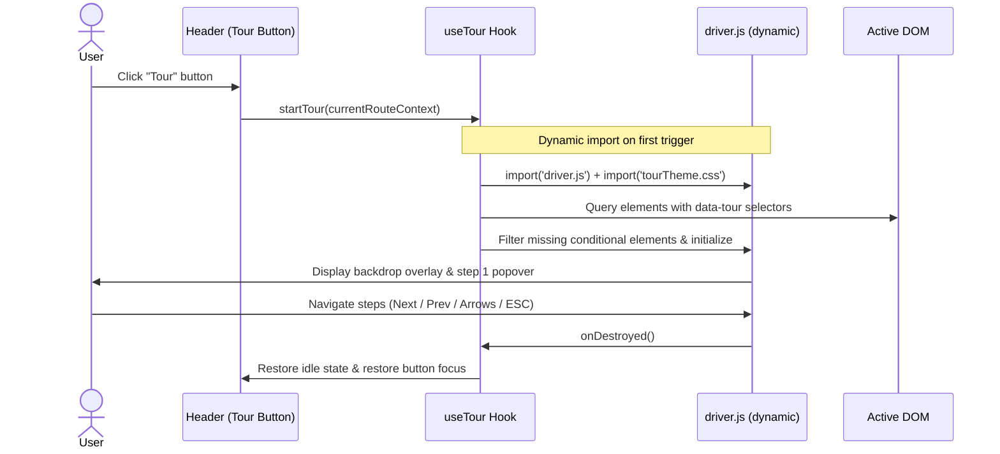

# Spec: Self-Serve Driver.js Feature Tours

**Status:** Ready for Implementation  
**Date:** 2026-10-05  
**Repo:** `arcgym` (`apps/arcgym-web`)  
**Companion:** Plan artifact — `driverjs-tours-plan.md`  

---

## 1. Locked Product Decisions

| Decision | Choice | Rationale |
| --- | --- | --- |
| **Trigger Mechanism** | **Single contextual button in the top navigation Header** | Centralized, clean, and accessible on every page without cluttering individual content layouts. |
| **Trigger Action** | **Immediate launch** | Clicking the button immediately starts the tour for the active view—no intermediate dropdown menus or modal prompts. |
| **Tour Scope** | **Strictly single-page** | Every tour is self-contained on the currently active view. Zero cross-page route navigation or redirect jumps during a tour. |
| **Activation Policy** | **Strictly user-initiated (self-serve only)** | No auto-starting on page load, first visit, or route transitions. Always on-demand and re-runnable at will. |
| **Bundle & Performance** | **Dynamic lazy-loading** | `driver.js` and its stylesheet are loaded dynamically only when the user clicks the "Tour" button (0 KB impact on initial page load). |
| **Visual Aesthetic** | **Miro design token parity** | Custom popover styles map to runtime CSS variables (`--miro-card`, `--miro-primary`, `--miro-hairline`, `--miro-blue`), ensuring 100% fidelity across light and dark themes. |
| **DOM Targeting** | **Semantic `data-tour="..."` attributes** | Robust against CSS/Tailwind refactors. Dynamically skips steps when target DOM elements are conditionally absent. |

---

## 2. Context & Motivation

ArcGym provides high-stakes architectural judgment practice for Salesforce Architects across 7 Architectural Domains. The platform introduces specialized training patterns:
- **Fast-Twitch Reps (Rapid Fire)** with inline system topology diagram inspection.
- **Universal Pre-Submit Confidence Gates** calculating Brier calibration scores.
- **Evaluation-scale Case Files** featuring narrative Briefs, 3+ Stations, and scarce Probe Budgets.
- **Incident Triage (Troubleshooting)** diagnosing architectural failures against gold causes and antipattern distractors.
- **Architectural Readiness Radars** tracking competency depth and calibration drift.

New and returning learners benefit from guided orientation, but forced onboarding walkthroughs disrupt focused practice. A self-serve, on-demand tour framework lets architects inspect feature mechanics whenever needed.

---

## 3. Goals

1. **Provide On-Demand Guidance**: Deliver clear, interactive, step-by-step walkthroughs for all 5 core platform experiences.
2. **Context-Sensitive Trigger**: Position a single, subtle "Tour" pill button in `Header.tsx` that inspects the active route and starts the matching tour immediately.
3. **Zero Performance Regression**: Keep initial bundle size intact via dynamic `import('driver.js')` and lazy-loaded tour assets.
4. **Theme Parity**: Popovers, backdrops, and controls must adapt automatically when users toggle between light and dark modes.
5. **Resilient DOM Contract**: Rely strictly on `data-tour` attributes with runtime element detection and safe fallbacks.

---

## 4. Non-Goals

- Involuntary / automated tour triggers on first visit or route change.
- Multi-page tours that programmatically transition between different routes.
- Audio narrations or video tour embeds.
- Modifying core scoring, telemetry, or attempt persistence in `@arcgym/drill-core`.
- Persistent blocking modals or invasive new-feature badges.

---

## 5. System Architecture & Component Design

All tour logic and assets reside within `apps/arcgym-web/src/tours/`.

```
apps/arcgym-web/src/
├── tours/
│   ├── index.ts               # Public exports (useTour, TourButton)
│   ├── types.ts               # Tour IDs, Step interfaces, options
│   ├── tourRegistry.ts        # Step definitions & route-to-tour resolver
│   ├── useTour.ts             # Dynamic loader, lifecycle, and theme coordinator
│   ├── tourTheme.css          # Miro design token CSS overrides for Driver.js
│   └── components/
│       └── HeaderTourButton.tsx # Header pill trigger button
```

### 5.1 Route-to-Tour Resolution

The top navigation `Header` resolves the appropriate tour based on the active path and URL search parameters:

| Active URL / Context | Resolved Tour | Focus Areas |
| --- | --- | --- |
| `/?workout=rapid-fire` | `rapid-fire-runner` | Rep round counter, scenario brief, topology inspection, trade-off options, confidence gate, post-commit rationale. |
| `/cases/:id` | `case-file-runner` | Enterprise brief, 3+ stations, probe budget, station recommendation, board debrief. |
| `/cases` | `cases-catalog` | CTA case catalog, domain tags, completion progress, case selection. |
| `/troubleshoot/:id` | `troubleshoot-runner` | Production failure synopsis, system topology, diagnostic probes, free-text cause hypothesis, cause bakeout. |
| `/troubleshoot` | `troubleshoot-catalog` | Architectural incident catalog, system failure categories, topology previews. |
| `/skills` | `skill-profile` | 7-domain readiness heptagon, domain volume/accuracy, calibration score, "Where to Start" recommendations. |
| `/` (default Gym Floor) | `gym-floor` | Daily workout hero, domain focus filters, 3 practice tracks, readiness snapshot, streak indicator. |

### 5.2 Dynamic Import Flow



---

## 6. Tour Step Specifications

### 6.1 Tour: Gym Floor (`gym-floor`)
* **Context**: Route `/`
* **Steps**:
  1. `data-tour="gym-brand"`: **Architectural Judgment Practice**  
     *Description*: ArcGym is a deliberate practice gym for Salesforce Architects, training high-stakes platform trade-offs across 7 domains and 3 training tracks.
     *Position*: `bottom`
  2. `data-tour="daily-workout-hero"`: **Today's Workout**  
     *Description*: Your daily recommended workout. Complete this daily assignment to earn and maintain your daily practice streak.
     *Position*: `bottom`
  3. `data-tour="domain-filter"`: **Architectural Domain Filters**  
     *Description*: Focus your practice on specific areas like Security & Access, Integration APIs, Data Architecture, or Platform Core.
     *Position*: `top`
  4. `data-tour="practice-tracks"`: **Three Practice Disciplines**  
     *Description*: Choose your track: Fast-Twitch Reps (Rapid Fire), Evaluation-scale CTA Case Files, or Real Incident Triage.
     *Position*: `top`
  5. `data-tour="readiness-snapshot"`: **Architectural Readiness**  
     *Description*: Live snapshot of your 7-domain proficiency and calibration metrics, showing where you excel and where to train next.
     *Position*: `top`
  6. `data-tour="header-streak"`: **Streak & Telemetry**  
     *Description*: Track consecutive practice days and sync your training telemetry to your account.
     *Position*: `left`

### 6.2 Tour: Rapid Fire Workout (`rapid-fire-runner`)
* **Context**: Route `/?workout=rapid-fire`
* **Steps**:
  1. `data-tour="rf-round-badge"`: **5-Rep Round**  
     *Description*: Each Rapid Fire set consists of 5 high-tempo decision reps. Complete all 5 reps to log your set and extend your streak.
     *Position*: `bottom`
  2. `data-tour="rf-scenario-card"`: **Architectural Tension**  
     *Description*: Read the real-world platform scenario and identify the underlying architectural trade-off.
     *Position*: `bottom`
  3. `data-tour="rf-diagram-preview"` *(conditional)*: **Topology Diagram & Inspect**  
     *Description*: When available, click the diagram to open a zoomable Inspect lightbox to audit system components and integration flows.
     *Position*: `bottom`
  4. `data-tour="rf-options-list"`: **Options & Antipattern Distractors**  
     *Description*: Evaluate solutions. Distractors represent common platform antipatterns or suboptimal governance choices.
     *Position*: `top`
  5. `data-tour="rf-confidence-gate"`: **Confidence Calibration Gate**  
     *Description*: Before committing, rate your confidence (Low, Medium, High). ArcGym scores your metacognitive calibration using Brier scoring.
     *Position*: `top`

### 6.3 Tour: CTA Case File (`case-file-runner`)
* **Context**: Route `/cases/:id`
* **Steps**:
  1. `data-tour="case-brief-section"`: **Enterprise Brief**  
     *Description*: The fictional enterprise scenario shared across all stations. Establishes the business objectives and technical landscape.
     *Position*: `bottom`
  2. `data-tour="case-stations-bar"`: **Evaluation Stations**  
     *Description*: Case Files feature 3 or more stations covering CTA review board domains (System Architecture, Data, Security, Integration).
     *Position*: `bottom`
  3. `data-tour="case-probe-budget"`: **Scarce Probe Budget**  
     *Description*: Clarifying questions cost probe budget. Pivotal probes reveal crucial requirements; distractor probes waste budget.
     *Position*: `bottom`
  4. `data-tour="case-station-rec"`: **Board Recommendation**  
     *Description*: Commit your architectural recommendation and justify platform trade-offs under simulated board evaluation.
     *Position*: `top`

### 6.4 Tour: Incident Triage (`troubleshoot-runner`)
* **Context**: Route `/troubleshoot/:id`
* **Steps**:
  1. `data-tour="incident-synopsis"`: **System Topology & Failure**  
     *Description*: Review the production failure report and examine the system topology diagram to pinpoint affected components.
     *Position*: `bottom`
  2. `data-tour="incident-probes"`: **Diagnostic Telemetry Probes**  
     *Description*: Spend scarce probes to inspect error logs, query metrics, or integration payloads to isolate the root cause.
     *Position*: `bottom`
  3. `data-tour="incident-cause-input"`: **Root Cause Commitment**  
     *Description*: Enter your technical root cause diagnosis in free-form text.
     *Position*: `top`
  4. `data-tour="incident-confidence"`: **Diagnosis Certainty**  
     *Description*: Calibrate your diagnostic confidence before submitting for grading.
     *Position*: `top`

### 6.5 Tour: Skill Profile (`skill-profile`)
* **Context**: Route `/skills`
* **Steps**:
  1. `data-tour="skills-radar"`: **Architectural Readiness Radar**  
     *Description*: Heptagon radar chart mapping your demonstrated proficiency across the 7 Salesforce Architectural Domains.
     *Position*: `bottom`
  2. `data-tour="skills-stats-grid"`: **Proficiency & Calibration Breakdown**  
     *Description*: Audit total points, completed reps, and calibration accuracy (distinguishing true knowledge from overconfidence).
     *Position*: `bottom`
  3. `data-tour="skills-strengths"`: **Demonstrated Strengths**  
     *Description*: Domains where you consistently choose optimal platform architectures with calibrated certainty.
     *Position*: `top`
  4. `data-tour="skills-where-to-start"`: **Targeted Recommendations**  
     *Description*: High-leverage practice recommendations prioritized by domain depth and opportunity for growth.
     *Position*: `top`

---

## 7. Visual Design & Theme Integration

Driver.js UI components are customized in `src/tours/tourTheme.css` using ArcGym's Miro CSS tokens:

```css
/* Light & Dark Backdrop Variables */
:root {
  --color-tour-overlay: rgba(15, 23, 42, 0.65);
}
.dark {
  --color-tour-overlay: rgba(0, 0, 0, 0.80);
}

/* Miro Popover Styling */
.arcgym-tour-popover.driver-popover {
  background-color: var(--miro-card);
  color: var(--miro-primary);
  border: 1px solid var(--miro-hairlineStrong);
  border-radius: 1rem;
  padding: 1.25rem;
  box-shadow: 0 10px 25px -5px rgba(0, 0, 0, 0.12), 0 8px 10px -6px rgba(0, 0, 0, 0.08);
  font-family: var(--font-sans);
  max-width: 340px;
}

.arcgym-tour-popover .driver-popover-title {
  font-size: 0.9375rem;
  font-weight: 600;
  color: var(--miro-primary);
  margin-bottom: 0.375rem;
  letter-spacing: -0.01em;
}

.arcgym-tour-popover .driver-popover-description {
  font-size: 0.8125rem;
  line-height: 1.5;
  color: var(--miro-slate);
}

.arcgym-tour-popover .driver-popover-progress-text {
  font-size: 0.75rem;
  font-family: ui-monospace, monospace;
  color: var(--miro-muted);
}

.arcgym-tour-popover .driver-popover-next-btn {
  background-color: var(--miro-primary);
  color: var(--miro-onPrimary);
  border-radius: 9999px;
  font-size: 0.75rem;
  font-weight: 500;
  padding: 0.35rem 0.85rem;
}

.arcgym-tour-popover .driver-popover-prev-btn {
  background-color: var(--miro-surfaceSoft);
  color: var(--miro-primary);
  border: 1px solid var(--miro-hairline);
  border-radius: 9999px;
  font-size: 0.75rem;
  font-weight: 500;
  padding: 0.35rem 0.85rem;
}

.arcgym-tour-popover .driver-popover-close-btn {
  color: var(--miro-muted);
}
.arcgym-tour-popover .driver-popover-close-btn:hover {
  color: var(--miro-primary);
}
```

---

## 8. Implementation Workstreams

### Workstream A: Foundation & Infrastructure
1. Add `driver.js@^1.9.0` to `apps/arcgym-web/package.json`.
2. Author `apps/arcgym-web/src/tours/types.ts` defining tour keys and step schemas.
3. Author `apps/arcgym-web/src/tours/tourTheme.css` with CSS token bridge.
4. Author `apps/arcgym-web/src/tours/useTour.ts` with dynamic import and lifecycle handlers.
5. Author `apps/arcgym-web/src/tours/tourRegistry.ts` registering step configurations.

### Workstream B: Header Trigger & Gym Floor
1. Add `HeaderTourButton` in `Header.tsx` (using `Compass` icon and pill styling).
2. Wire `onStartTour` in `App.tsx` passing current route context.
3. Annotate `GymFloor.tsx` elements with `data-tour="..."` attributes.
4. Verify Gym Floor tour flow and light/dark theme parity.

### Workstream C: Workout Runners
1. Annotate `RapidFireRunner.tsx` elements (`rf-round-badge`, `rf-scenario-card`, `rf-diagram-preview`, `rf-options-list`, `rf-confidence-gate`).
2. Add conditional filtering in `tourRegistry.ts` for diagrams.
3. Annotate `CasePage.tsx` / `CaseFileRunner.tsx`.
4. Annotate `TroubleshootPage.tsx` / `TroubleshootRunner.tsx`.

### Workstream D: Catalog & Profile Pages
1. Annotate `SkillProfilePage.tsx` elements.
2. Annotate `CasesPage.tsx` and `TroubleshootCatalogPage.tsx`.

### Workstream E: Hardening & Verification Gates
1. Verify keyboard navigation: `ESC` cancels tour cleanly, `Right Arrow` advances, `Left Arrow` steps back.
2. Verify element focus is restored to the Tour button on finish or cancel.
3. Verify mobile viewport responsiveness.
4. Execute monorepo verification suite:
   ```bash
   pnpm typecheck
   pnpm check
   pnpm check:arch
   pnpm check:dead
   pnpm test
   ```
